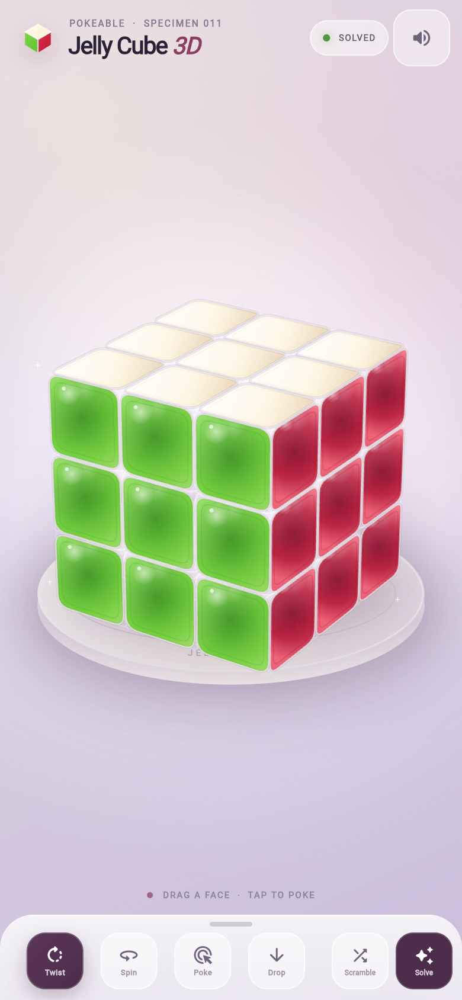
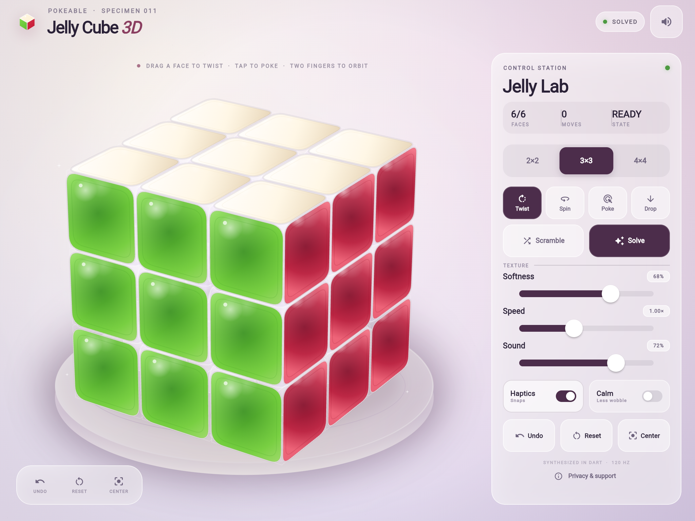
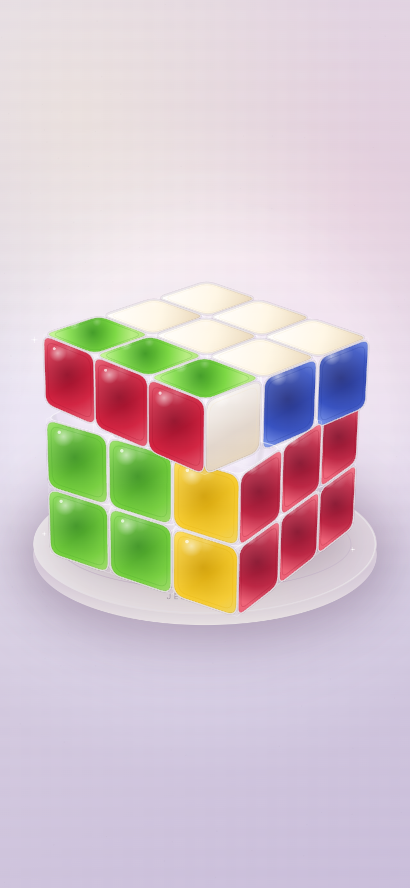
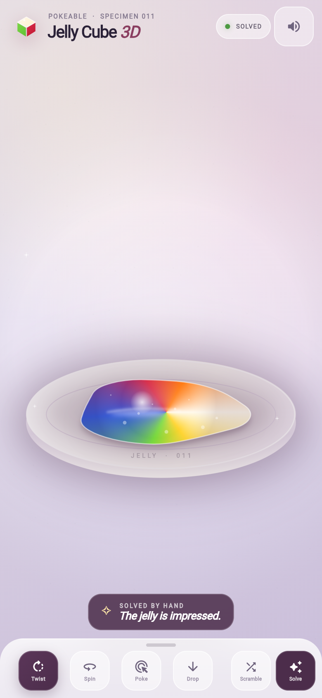

# Jelly Cube 3D

A glossy, soft-body twisty puzzle built natively in Flutter. Every sticker, highlight, shadow, wobble, and sound is generated in code — there are no runtime image, audio, or font assets. Gameplay is fully offline; the optional Extra Cube Types purchase is handled by the platform store (Play Billing declares INTERNET only for store communication).

> **Release status:** the product is **not store-submittable yet**. The rebrand, production IDs, app icons, privacy manifest, legal drafts, build scripts and CI skeleton are in place; the IAP flow, App Store distribution signing, signed HarmonyOS runtime validation, and console records remain open. Android upload signing, app icons, privacy manifest and store screenshot sets are in place. See [`RELEASE_READINESS.md`](RELEASE_READINESS.md) and [`DECISIONS.md`](DECISIONS.md).

The public entry point is [`lib/jelly_cube_3d.dart`](lib/jelly_cube_3d.dart). The implementation is split into a small cohesive module under [`lib/src`](lib/src).

| Phone | Tablet | Demo frame | Hand-solved puddle |
| --- | --- | --- | --- |
|  |  |  |  |

The images in [`screenshots`](screenshots) are documentation only; they are not bundled into the app or referenced by runtime code.

## Release package

- [Release readiness audit](RELEASE_READINESS.md)
- [Release runbook](RELEASE.md)
- [Decisions](DECISIONS.md)
- [Accounts and signing checklist](ACCOUNTS_AND_SIGNING.md)
- [IAP plan](docs/IAP.md)
- [QA report](docs/QA_REPORT.md)
- [Draft store answers](docs/STORE_ANSWERS.md)
- [HarmonyOS spike report](docs/HARMONY_SPIKE.md)
- [Privacy policy](docs/PRIVACY.md), [Terms](docs/TERMS.md), [Support](docs/SUPPORT.md)
- [Store asset workspace](store/README.md), [English listing](store/listing-en.md), [Chinese listing](store/listing-zh-Hans.md), [static legal site](store/site/README.md)
- [Apple IAP setup](store/apple/iap-product.md), [Google IAP setup](store/google/iap-product.md), [Huawei IAP status](store/huawei/iap-product.md)
- [Build script](scripts/build-release.sh), [verification script](scripts/verify-release.sh), [CI tests](.github/workflows/ci.yml), [release workflow](.github/workflows/release.yml)

## Run it

```bash
flutter pub get
flutter run                 # pick an iPhone / iPad / Android target
flutter run -d chrome       # CanvasKit
```

WebAssembly is also supported:

```bash
flutter build web --wasm --release
```

## Demo mode

The launch URL accepts:

| Parameter | Meaning |
| --- | --- |
| `demo=true` | Hide every piece of UI and run the muted 4.0-second art-directed loop. |
| `demo=true&demo_t=1.7` | Freeze the deterministic loop at an exact timestamp. |
| `size=2` … `size=6` | Boot at 2×2 through 6×6. |
| `preview=melt` | Hidden art-direction route: show the hand-solved rainbow puddle. |
| `preview=melt&melt_t=1.5` | Freeze the puddle at an exact melt time. |

`JellyCubeController.startDemo({double? freezeAt})` exposes the same behaviour programmatically. The demo camera is fixed at the 3/4 view and all audio initialisation is skipped.

## Controller / test hook

`JellyCubeApp.of(context)` returns the live controller. You can also construct `JellyCubeController()` directly.

```dart
final c = JellyCubeApp.of(context)!;
c.move("R");
c.move("U'");
c.move('F2');
c.drag(const Offset(190, 420), const Offset(240, 360));
c.pick(const Offset(190, 420)); // cubelet id, position, face index
c.spin(12, -4);
c.poke(const Offset(190, 420), 0.8);
c.drop();
await c.scramble(seed: 42);
await c.solve();
c.undo();
c.reset();
c.setSize(4);
c.setTool(JellyTool.poke);
c.state(); // size, faces, solved, solvedFaces, moves, history, busy, …
```

Moves support face turns, primes, doubles, lowercase wide turns (`r`, `u`, …), `Rw`, and `M/E/S`. `solve()` simplifies and then unwinds the move history in at most eight seconds. Any pointer interaction during a solve cancels it cleanly.

## What is in the box

- [`lib/src/engine.dart`](lib/src/engine.dart) — discrete integer cube state. Positions are doubled lattice integers and orientations are 3×3 orthogonal integer matrices. There is no floating-point drift; 10,000 random turns are covered by a test.
- [`lib/src/controller.dart`](lib/src/controller.dart) — application logic, 120 Hz fixed-step spring physics, body rock, drop/squash, pokes, solve/scramble orchestration, demo director, haptics, and the public hook.
- [`lib/src/geometry.dart`](lib/src/geometry.dart) — perspective camera, 3/4 projection, fuzzy 12 dp raycast picking, drag axis resolution.
- [`lib/src/painter.dart`](lib/src/painter.dart) — the complete software/vector rendering path: rounded jelly cubelets, thick flavor rims, Beer–Lambert-style center-to-rim gradients, Fresnel edges, wet glints, frosted core, ceramic plate, contact shadows, puddle, and toasts. It is a valid renderer even if shaders are unavailable.
- [`shaders/jelly_gloss.frag`](shaders/jelly_gloss.frag) — an optional procedural optical bloom pass loaded through `FragmentProgram.fromAsset`. If compilation or loading fails, the app continues on the painter path with no visible error.
- [`lib/src/audio.dart`](lib/src/audio.dart) — deterministic PCM synthesis (noise, filters, oscillators, envelopes) for twist, spin, poke, drop, scramble, solve, bloop, and snap. There are eight pre-rendered 44.1 kHz buffers and a 16-voice ceiling.
- [`lib/src/audio_io_web.dart`](lib/src/audio_io_web.dart), [`lib/src/audio_io_native.dart`](lib/src/audio_io_native.dart) — Web Audio / platform-channel PCM playback. The iOS, Android, and macOS hosts live in the native Runner sources.
- [`lib/src/ui.dart`](lib/src/ui.dart) — the responsive instrument: phone bottom sheet, tablet glass card, thumb capsule, tool ergonomics, and the flavor legend.
- [`lib/src/purchases.dart`](lib/src/purchases.dart), [`lib/src/purchase_ui.dart`](lib/src/purchase_ui.dart) — StoreKit/Play Billing entitlement, one-time Extra Cube Types unlock, restore and offline cache.
- [`ohos/`](ohos/) — Flutter-OHOS host project (HarmonyOS NEXT), with the generated HAP validated in a sanitized path. ArkTS audio and signing remain open.
- [`tool/test.sh`](tool/test.sh) — test runner that stages the project in a path without an apostrophe (a current Flutter test-listener URI quirk).

## Touch model

- Edge guard: 24 dp.
- Axis lock: 10 dp movement; shorter presses under 450 ms resolve as a tap/poke.
- Two touches immediately preempt a slice, then orbit + pinch the camera.
- 12 dp fuzzy pick tolerance around projected cubelet face polygons.
- Stylus bypasses slop and uses pressure for dent depth.
- All interactive targets are at least 48×48 dp; sliders use 48 dp rows and 28 dp thumbs.

## Verification

Run the suite with:

```bash
tool/test.sh
```

A 29-test suite currently covers:

- 10,000 random turns in the discrete engine.
- 10,000 moves through the public controller, checking the integer state stays intact.
- `(R U R' U') × 6` returns strictly to solved.
- 2×2 through 6×6 shell counts and stage drags.
- Real stage drags, tool selection, drop physics, and a two-finger preemption smoke test.
- Manual hand-solve melt easter egg.
- Controller-triggered demo hiding all chrome.
- Scramble → solve round trip.
- Frozen demo frame at `t=1.7`.
- Finite, bounded PCM for every synthesized sound.

`flutter analyze` is clean.

## Platform builds verified

- Flutter Web: CanvasKit and Wasm release builds.
- iOS: App Store distribution IPA builds with an app-specific profile and runs on iPhone/iPad simulators; upload/App Store Connect verification is still manual.
- Android: release AAB/APK builds signed with the app-specific upload key; Play App Signing enrollment is pending.
- HarmonyOS: Flutter-OHOS 3.41.10 HAP compiles from `ohos/` in a sanitized path; the unsigned HAP installs and runs on the OpenHarmony 7 emulator (launch + drag/turn). The AppGallery build hides paid 5×5/6×6 until Huawei IAP Kit is implemented; signed HAP verification is pending.
- macOS: debug app builds for local inspection only; Mac App Store is out of scope.

## Design notes

The palette is a dessert-studio lilac with plum ink and six deliberately separated flavors: creamy coconut (U), lemon (D), lime (F), blueberry (B), cherry (R), tangerine (L). Cherry and tangerine use different hues, lightness, and center depth so they remain distinct under deformation; coconut is opaque ivory and lemon is a saturated yellow.

The app is intentionally runtime-asset-free. The only platform-provided font is the Material icon font used for UI glyphs. The jelly geometry, plate, grain, glints, shadows, puddle, and all audio samples are generated at runtime. Store icons, launch art and the feature graphic are procedural build-time assets generated by [`tool/generate_brand_assets.py`](tool/generate_brand_assets.py); they are not loaded by gameplay.
